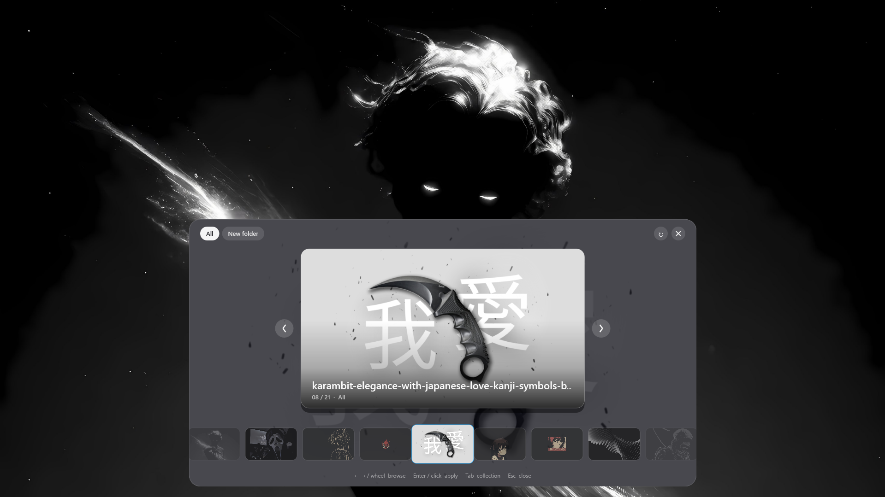

# Wallpaper Changer For Windhawk

Change your Windows wallpaper from a visual selector, opened with a hotkey. A [Windhawk](https://windhawk.net) mod.

Press **Ctrl+Alt+P**, pick a wallpaper, press **Enter**. That is the whole idea.

 

Point the mod at a folder of wallpapers. Every subfolder becomes a collection. The hotkey opens a
selector over your desktop, you browse with the keyboard, the mouse wheel or by dragging, and the
wallpaper changes only when you confirm. It goes to every monitor, or only to the one the selector
opened on if you prefer (see [Several monitors](#several-monitors)).

## How it differs from Simple Wallpaper Switcher

[Simple Wallpaper Switcher](https://windhawk.net/mods/simple-wallpaper-switcher) is a compact utility
picker: a paged thumbnail grid with folder navigation and search, themes and a tray icon. This mod is
a gallery instead. You browse one wallpaper at a time, large, with the keyboard or by dragging, and
the selector and the effect are one motion: the card you pick grows from where it was on screen until
it is the wallpaper, and the overlay stays until the desktop really shows it. If you want search,
themes or a tray icon, Simple Wallpaper Switcher is the better fit.

## Styles

Pick the look with the **Style** setting. It takes effect the next time the selector opens.

### Card carousel

A fan of overlapping cards, the centre one in front, with your collections as tabs at the bottom.

### Folder strip

Slanted cards side by side. You browse your folders first, press **Enter** to open one, and then pick
the wallpaper. **Esc** or **Backspace** goes back to the folders.

### Showcase

A big preview of the selected wallpaper over a dimmed copy of itself, with a rail of thumbnails
underneath. Moving between wallpapers crossfades them. Collections are chips along the top.

## Transitions

When you confirm a wallpaper, an effect plays over the desktop while Windows changes the wallpaper
underneath it. Pick it with the **Transition** setting:

- **Card expand** (default): the card you picked grows from where it was until it covers the
  monitor, its corners straightening as it goes.
- **Blinds**: horizontal slats open from their middle line, from the top down.
- **Pixelate**: the new wallpaper fades in as a coarse mosaic that sharpens into the picture.
- **Tile wave**: tiles grow in a wave that starts at the card.
- **Random** picks one each time, and **None** changes the wallpaper instantly.

The effect plays on every monitor the wallpaper is applied to. It stays on screen until Windows has
repainted the desktop (a couple of seconds at most), so the old wallpaper never flashes back. The
desktop icons are covered meanwhile. If the picture position in Windows is Tile or Span, the
wallpaper changes instantly.

## Several monitors

The selector opens on the monitor with the mouse, or on the one with the focused window if you set
**Open the selector on** to that. By default the wallpaper and the effect go to every monitor. Turn on
**Only change the current monitor** and just the monitor the selector opened on changes, with the
effect playing only there. If Windows cannot match that monitor, every monitor changes and the mod
log says so.

> This part has only been tested on a single monitor. If you have several, feedback is very welcome.

## Install

1. Install [Windhawk](https://windhawk.net).
2. In Windhawk, choose **Create a new mod**, replace the code with the contents of
   [`wallpaper-changer.wh.cpp`](wallpaper-changer.wh.cpp), then **Compile Mod** and enable it.
3. Open the mod settings and set **Wallpapers folder**. Empty means your Pictures folder.

## Keys

| Key | Action |
| --- | --- |
| `Ctrl+Alt+P` (configurable) | Open or close the selector |
| Arrow keys, mouse wheel, drag | Move through the wallpapers |
| `Home` / `End` | First / last wallpaper |
| `Enter`, or a click on the selected one | Apply it (in the Folder strip, open the folder first) |
| `Tab` / `Shift+Tab` | Next / previous collection |
| `F5` | Rescan the folder |
| `Backspace` | Back to the folders (Folder strip) |
| `Esc`, or clicking another window | Close without changing anything |

## Settings

| Setting | Default | Notes |
| --- | --- | --- |
| Wallpapers folder | your Pictures folder | Every subfolder becomes a collection. Quotes around the path and `%VARIABLES%` are accepted. Empty scans the whole Pictures folder (up to 5000 images), so a folder just for wallpapers is better. |
| Style | Card carousel | Card carousel, Folder strip or Showcase. |
| Transition | Card expand | Card expand, Blinds, Pixelate, Tile wave, Random or None. |
| Only change the current monitor | off | Off: every monitor changes and plays the effect. On: only the monitor the selector opened on. |
| Open the selector on | The monitor with the mouse | Or the monitor with the focused window. |
| Hotkey | `Ctrl+Alt+P` | At least one modifier (Ctrl, Alt, Shift, Win) plus a letter, a digit or F1-F24. |

## Notes

- Supported images: JPG, JPEG, PNG, BMP and WebP (WebP needs the Windows WebP codec). The folder is
  scanned each time the selector opens, up to 5000 images.
- Applying a wallpaper changes the Windows desktop wallpaper setting, so Windows keeps it after the
  mod is disabled. It also replaces a Slideshow or Windows Spotlight background, and with **Only
  change the current monitor** the wallpaper is saved for that monitor only.
- The mod runs as a Windhawk tool mod, in its own `windhawk.exe` process, so a crash in it cannot
  take down Explorer, the taskbar or the desktop.
- Previews are decoded with the Windows imaging components in that process, on a low-priority
  background thread. Images above roughly 150 megapixels show "No preview" instead of being decoded.
- Nothing runs in the background while the selector is closed, apart from the hotkey itself and, for
  a couple of seconds after you pick a wallpaper, the transition.

See the [changelog](CHANGELOG.md) for what changed in each version.

## Contributing

Bug reports, fixes, new features, translations and documentation corrections are welcome. Open an
[issue](https://github.com/DavidRaveloU/Wallpaper-Changer-Windhawk/issues) with your Windows build,
the mod version, the steps to reproduce it and, when it is visual, a screenshot or a short clip.

For a pull request: fork, branch from `main`, change `wallpaper-changer.wh.cpp`, confirm it compiles
and open the PR describing **what** changed and **why**. One bug or feature per PR is much easier to
review.

Leave `@version` in the mod header and `version.json` alone: the maintainer sets both when a release is
published on Windhawk, so they always agree with what the store shows.

## License

MIT. See [LICENSE](LICENSE).
